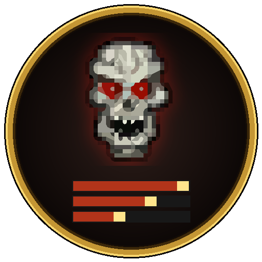

# SurvivorPlates

An [Azeroth Survivors](https://discord.gg/azerothsurvivors) addon. It's a companion to **SurvivorsDragonUi** that adds nameplate settings: collapsing piles of mobs into one plate, size, and target highlighting.

Click the minimap button or type `/asp` in game to open the settings. Every change shows at once.

## Settings

The window has two columns. Every change shows at once, and the mouse wheel nudges any slider.

**Nameplates** (left): the plates above the mobs. These apply in every mode.
- **Show nameplates above mobs:** untick it to hide every plate above the mobs. They can't be clicked either. The pile bars then list single mobs too, so nothing goes missing.
- **Piles of mobs:** **Spread** (the default) leaves plates where the game puts them, one per mob. **Collapse piles** shows one plate per pile, with a count ("Gurubashi Scout x12"); the pile's other plates are hidden and can't be clicked. If your target is in a pile, the pile shows your target's plate.
- **Size:** width, height, scale, font size, name position (above, inside, hidden), health text.
- **Target and bosses:** target scale, a gold border on the target, fading other plates while you have a target, and a separate scale for bosses and guardians.

There's no overlap mode. The game spreads its plates before any addon sees them, and doesn't tell addons where a mob's head really is, so plates can't be put back on top of each other.

**Pile bars** (right): a panel listing each pile as a bar, like boss bars, with the mob's name, the pile's count and its average health. It works with either nameplate mode. Click a bar to target the nearest mob with that name.
- **How piles form** (shared with Collapse piles):
  - A plate that touches any plate in a pile joins it, whatever the mob. Plates of the same mob are also picked up from a few plate rows away, and piles that touch merge.
  - A plate only leaves its pile when its mob dies. A plate the game hides for a moment (off screen, out of range) keeps its place for a minute.
  - Bosses and guardians are never piled.
  - **Sideways overlap to join:** lower picks up same-mob plates from further to the side.
- **Order:** bosses and guardians are pinned nearest the fixed edge with a skull (white boss, red final boss, gold guardian). After them, bars go by the pile's total health, most first. Two piles only swap once one has 15% more health, so the order stays steady.
- **Placement:**
  - **Position:** **Where you drag it** (untick **Lock pile bars** to move it), **Above your character** or **Below your character**. The camera keeps your character in the middle of the screen, so above or below means a set offset from the middle.
  - **Grow (where you drag it):** **Upward** keeps the bottom row and drag strip still with the most health at the bottom; **Downward** is the inverse. Above your character always grows up, below always down.
  - **Vertical offset:** lines the stack up with your UI. **+** moves it up, **-** down, a pixel at a time, or click the value under the slider and type one. Above and below each keep their own offset.
  - The fixed edge never moves. Bars that don't fit before the edge of the screen are left off, least health first.
- **Look:** **Most pile bars**, **Pile bars scale**, and **Damage in the dealer's class colour**: damage taken shows as a chunk on the bar that holds for a moment, then drains away, in the class colour of whoever dealt most of it (your partner's only if the game reports their hits in the combat log; check with `/asp combatlog`). Unticked, chunks are pale gold. Boss and guardian bars don't drain: their missing health stays split into class-coloured segments by each player's share of the damage for the whole fight. Pile bars get a thin strip along the bottom showing each player's share of the damage on that mob. **Contribution strip measures** sets what it covers: **A set time back** (typed in as hours, minutes and seconds, up to 2 hours) or **As long as the pile is up**.

**Show minimap button** is at the bottom of the window.

Settings are per character.

## Commands
- `/asp`: open or close the settings
- `/asp reset`: back to defaults
- `/asp minimap`: show or hide the minimap button
- `/asp status`: whether it's hooked into SurvivorsDragonUi, how many plates it sees and how many are hidden in piles
- `/asp combatlog`: start, then stop, recording which combat log events the game sends, with a sample of each
- `/asp debug`: a cyan dot where the game places each plate, hidden ones included

## Requirements
SurvivorsDragonUi with its nameplate skin on. SurvivorPlates resizes and hides that skin, so it does nothing without it. If a SurvivorsDragonUi update changes how its plates are built, SurvivorPlates switches itself off and says so in chat.
